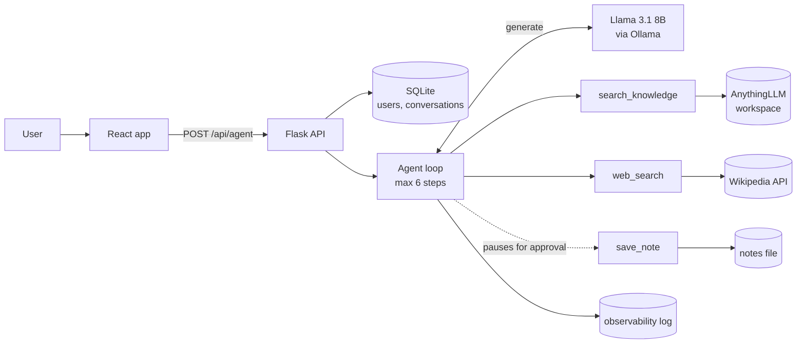

# Research Aide

**An AI agent that answers questions from your team's documents and the open web, shows every step it took, and asks before it does anything consequential.**

Built by Christin J, Adrian S, Sonal T and Steven R as a 4-week apprentice project (Option B, *Research Aide*). The original project brief is in [`docs/project-brief.md`](./docs/project-brief.md).

<!-- [placeholder] Add the 60–90s demo recording as docs/images/demo.gif, then uncomment:

-->

## The problem

A new team member trying to answer a question (*"When can I start working remotely?"*, *"How much does Nimbus Pro cost?"*, *"What is a vector database?"*) has to dig through internal documents and the web separately, and can't easily tell where an answer came from.

**Research Aide** takes the question, decides where to look, and answers with its source. It searches the internal knowledge base first and the web for general topics, says "I don't know" instead of guessing, and pauses for approval before saving anything.

## What it does

- **Answers from two sources.** `search_knowledge` queries our documents in AnythingLLM; `web_search` queries Wikipedia. The model chooses the tool for each question.
- **Shows its work.** A trace panel lists every step: the tool, its arguments and what came back, including links to web pages.
- **Asks before acting.** Saving a note pauses on a *Needs your confirmation* card. Nothing is saved until the user clicks **Confirm**, and each approval works only once.
- **Stays honest.** Answers come only from tool results; if they don't contain the answer, it says the documents don't mention it.
- **Is observable.** Every model and tool call is logged with its inputs, output and timing, and each answer links to its full log.
- **Keeps each user's work private.** Sign up and log in; your questions, answers and run logs are saved in a database and only you can see them.
- **Is evaluated.** A 10-task evaluation set measures the success rate (currently **30/30**; see [Evaluation](#evaluation)).

<!-- [placeholder] Add annotated screenshots to docs/images/ and link them here:
     1. An answer with the agent trace   2. The confirmation card   3. A run's observability log -->

## How it works



A question goes from the React app to the Flask API. The **agent loop** asks the model what to do next; the model either calls a tool or answers. The loop runs the tool, feeds the result back, and repeats until there's an answer or it hits the 6-step limit. Full details and design decisions: [`docs/ARCHITECTURE.md`](./docs/ARCHITECTURE.md).

### Tech stack and choices

| Part | Choice | Why |
|------|--------|-----|
| Knowledge service | **AnythingLLM** (Docker) | A production-grade RAG app we run rather than rebuild; we call its workspace chat API in query mode |
| Agent model | **Llama 3.1 8B** via **Ollama** | Free, local, private, and supports tool calling. Less reliable than hosted models, so we added input checks, a step limit and an eval set |
| Web search | **Wikipedia API** | Free and needs no API key; returns titles, URLs and summaries we can cite |
| Backend | **Python 3.12 + Flask** | Hosts the agent loop, the tools, and the observability log |
| Auth + storage | **Flask sessions + SQLite** | Passwords hashed with Werkzeug; SQLite needs no server and survives restarts |
| Frontend | **React 19 + Vite** | Chat UI with the trace panel and confirmation card |
| Tests / CI | **pytest** + **GitHub Actions** | Every pull request runs the backend tests; the model and services are faked, so CI needs no live model |

## Run it locally

### Prerequisites

[Docker Desktop](https://www.docker.com/products/docker-desktop/), [Ollama](https://ollama.com/download), [Python 3.11+](https://www.python.org/) and [Node.js 22 LTS](https://nodejs.org/) (Vite needs 20.19+ or 22.12+).

### 1. Pull the model

```bash
ollama pull llama3.1:8b
```

### 2. Start AnythingLLM and load the documents

```bash
docker run -d -p 3001:3001 \
  -e STORAGE_DIR=/app/server/storage \
  -v anythingllm_storage:/app/server/storage \
  --name anythingllm mintplexlabs/anythingllm
```

Open http://localhost:3001 and:

1. **LLM:** choose **Ollama**, model `llama3.1:8b`, base URL **`http://host.docker.internal:11434`** (not `localhost` — inside the container, `localhost` is the container itself).
2. Under **Show advanced settings**, set **Model context window** to `4096` and **Keep Alive** to 1 hour. A different context window from the agent makes Ollama reload the model on every call, and searches time out.
3. Create a workspace named **`apprentice-kb`**, upload the files in [`sample-data/`](./sample-data) (not its README), and click **Save and Embed**.
4. In the workspace's settings, set **Chat mode** to **Query**, so it answers only from the documents.
5. **Settings → Developer API → Generate New API Key.**

More detail: [`docs/anythingllm-setup.md`](./docs/anythingllm-setup.md).

### 3. Configure

```bash
cp .env.example .env        # Windows PowerShell: copy .env.example .env
```

Paste your API key into `.env` as `ANYTHINGLLM_API_KEY`, and set `SECRET_KEY` to any long random string (it signs login sessions). The other defaults work as they are; the database file is created on first start.

### 4. Start the backend (terminal 1)

```bash
cd server
python -m venv .venv
source .venv/bin/activate   # Windows: .venv\Scripts\activate
pip install -r requirements.txt
flask run                   # http://localhost:5000
```

### 5. Start the frontend (terminal 2)

```bash
cd client
npm install
npm run dev                 # http://localhost:5173
```

Open **http://localhost:5173**, create an account, and try:

- *How much does Nimbus Pro cost?* — answered from the internal docs
- *Who created the Python programming language?* — answered from the web
- *What is Acme's parental leave policy?* — not in the docs, so it says it doesn't know
- *Save a note titled "Nimbus" with the content "Pro is $8/month"* — pauses for your confirmation

### Common problems

| Symptom | Fix |
|---------|-----|
| `Connection refused` on port 3001 | Start Docker Desktop, then `docker start anythingllm` |
| "Couldn't reach the model" | Start Ollama (open the Ollama app, or `ollama serve`) |
| The first answer takes 20–50s | The model is loading (a cold start). The app warms it up when you click into the question box; later answers take about 6s |
| `search_knowledge` times out | Check AnythingLLM's model context window is `4096` (step 2) |
| `401`/`403` from AnythingLLM | Check `ANYTHINGLLM_API_KEY` in `.env` |
| `flask` or `pytest` not found | Activate the virtual environment (`.venv\Scripts\activate`) |

## API

| Method | Path | Purpose |
|--------|------|---------|
| `GET` | `/health` | Health check |
| `POST` | `/api/signup` | Create an account and log in: `{"username", "password"}` (3–30 letters, digits or `_`; password 8+ characters) |
| `POST` | `/api/login` | Log in: `{"username", "password"}` |
| `POST` | `/api/logout` | Log out |
| `GET` | `/api/me` | The signed-in user, or `401` |
| `GET` | `/api/conversations` | The signed-in user's saved questions, answers and steps, newest first |
| `POST` | `/api/agent` | Ask a question: `{"question": "..."}` → `{answer, steps, run_id, duration_ms, pending_action?}` |
| `POST` | `/api/warmup` | Load the model in the background (called when the question box gets focus) |
| `POST` | `/api/actions/<id>/confirm` | Run an action the agent paused on (once only) |
| `POST` | `/api/actions/<id>/cancel` | Discard it |
| `GET` | `/api/runs` | Your recent runs: question, answer, total time, number of model and tool calls |
| `GET` | `/api/runs/<run_id>` | Every logged model and tool call for one run |

Every `/api/` endpoint except signup, login, logout, me and warmup requires login, and only returns the signed-in user's data; confirming someone else's pending action returns `404`.

## Testing and evaluation

```bash
cd server
pytest                          # unit tests; the model and services are faked
python evaluate.py --repeat 3   # evaluation set against the real agent (~3 minutes)
```

```bash
cd client
npm run lint && npm run build
```

### Evaluation

10 tasks with known answers (7 answerable from our docs, a PDF and the web; 3 the agent should decline), each run 3 times:

| Run | Passed | Right tool | Avg time |
|-----|--------|------------|----------|
| Baseline | 27/30 | 27/30 | 6.4s |
| After prompt and tool-description fixes | **30/30** | **30/30** | 5.1s |

The biggest fix came from the trace: the agent was rewriting *"When can a new Acme employee start working remotely?"* into the vague search *"Acme remote work policy"*, so it got the wrong part of the policy. Telling it to search with the user's specific question fixed it. Full results and what we learned: [`docs/eval.md`](./docs/eval.md).

## Guardrails

- **Step limit:** the loop stops after `MAX_AGENT_STEPS` (6).
- **Timeouts:** 60s per tool call, 120s per model call; slow or offline services return an error, never a crash.
- **Input checks:** unknown tools, wrong argument names and empty or oversized inputs are rejected and reported back to the model.
- **Confirmation:** tools marked `requires_confirmation` pause and return a pending action stored on the server; it runs only when the user confirms, and only once.
- **Prompt-injection defense:** the system prompt tells the model that tool results are data, never instructions to follow.
- **Authentication:** passwords are hashed, never stored; the same error for a wrong username or password; each user sees only their own conversations, runs and pending actions.
- **No secrets in the repo:** keys live in `.env`, which is git-ignored.

## Project structure

```
.
├── client/                  React app (Vite)
│   └── src/                 App, TracePanel, ConfirmCard, LoadingState, Login, Signup
├── server/                  Flask API
│   ├── app.py               HTTP endpoints
│   ├── auth.py              signup, login, logout, login_required
│   ├── db.py                SQLite: users and conversations
│   ├── agent.py             the agent loop, confirmation and system prompt
│   ├── llm.py               generate(): the one place that calls the model
│   ├── observability.py     @observe logging and the run viewer
│   ├── evaluate.py          the evaluation set
│   ├── tools/               search_knowledge, web_search, save_note, registry
│   └── tests/
├── docs/                    architecture, evaluation, setup notes, original brief
├── sample-data/             documents for the knowledge base
└── .github/workflows/       CI
```

## Known limitations and next steps

- Pending actions live in server memory (lost on restart) and notes in a local file; they could move to the database.
- SQLite suits one server; a real deployment would use Postgres.
- The local 8B model's answers vary between runs (the web-search task scored 1/3 and 3/3 with the same settings), which is why the eval runs every task 3 times.
- Possible next steps: document upload from the UI, a readable run-viewer page, a retry when the model sends malformed tool arguments, and streaming each step live.

## Team and workflow

Christin J · Adrian S · Sonal T · Steven R

Every change went through an issue, a branch, a reviewed pull request and CI. See [`CONTRIBUTING.md`](./CONTRIBUTING.md) for the workflow.
