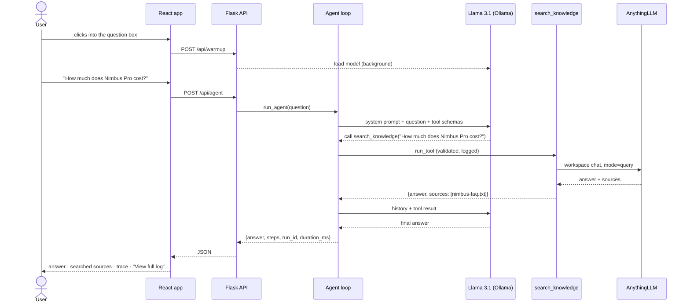

# Architecture

How Research Aide is put together, and why. For setup, see the [README](../README.md).

## Components

```mermaid
flowchart TB
    subgraph Browser
        UI[React app<br/>App · TracePanel · ConfirmCard · LoadingState]
    end

    subgraph Flask["Flask API (server/)"]
        APP[app.py<br/>HTTP endpoints]
        AGENT[agent.py<br/>agent loop · system prompt · pending actions]
        LLM[llm.py<br/>generate · warm_up]
        REG[tools/registry.py<br/>tool schemas + functions]
        OBS[observability.py<br/>@observe · run log]
    end

    subgraph Tools["tools/"]
        SK[search_knowledge]
        WS[web_search]
        SN[save_note<br/>requires confirmation]
    end

    UI -->|/api/* via Vite proxy| APP
    APP --> AGENT
    AGENT --> LLM
    AGENT --> REG
    REG --> SK & WS & SN
    LLM -->|/api/chat| OLLAMA[(Ollama<br/>llama3.1:8b)]
    SK -->|workspace chat, query mode| ALLM[(AnythingLLM<br/>apprentice-kb)]
    ALLM --> OLLAMA
    WS --> WIKI[(Wikipedia API)]
    SN --> NOTES[(server/data/notes.json)]
    LLM -.-> OBS
    AGENT -.-> OBS
    OBS --> RUNS[(server/data/runs.jsonl)]
```

| Component | Responsibility |
|-----------|----------------|
| **React app** (`client/src/`) | Sends the question to `/api/agent`; shows the answer, the sources searched, the step-by-step trace, a confirmation card for pending actions, and a loading skeleton while it waits. Calls `/api/warmup` when the question box first gets focus. |
| **`app.py`** | The HTTP layer: validates input, calls the agent, exposes the run viewer and the confirm/cancel endpoints. |
| **`agent.py`** | The agent loop, the system prompt, and the store of actions waiting for approval. |
| **`llm.py`** | `generate(messages, tools)`, the **only** place that calls the model, so swapping models is a one-file change. Also `warm_up()`. |
| **`tools/registry.py`** | Every tool's function and the schema the model sees, in one dictionary. Adding a tool means adding an entry. |
| **`observability.py`** | The `@observe` decorator that logs each model and tool call, plus reading runs back for the viewer. |
| **AnythingLLM** | Our knowledge service: stores and embeds the documents, retrieves relevant chunks, and answers from them (query mode). We run it; we don't modify it. |
| **Ollama** | Runs Llama 3.1 8B locally for both the agent and AnythingLLM. |

## What happens when you ask a question



Each round of the loop is one model call. The model either asks for tools or gives a final answer. The loop stops at the answer, on a model error, when an action needs confirmation, or after `MAX_AGENT_STEPS` (6).

## The confirmation flow

```mermaid
sequenceDiagram
    actor User
    participant UI as React app
    participant API as Flask API
    participant Agent as Agent loop
    participant Note as save_note

    User->>UI: "Save a note titled 'Nimbus' ..."
    UI->>API: POST /api/agent
    API->>Agent: run_agent
    Agent->>Agent: model asks for save_note (requires_confirmation)
    Agent->>Agent: store action under a random id in PENDING_ACTIONS
    Agent-->>UI: pending_action {id, tool, arguments}
    UI-->>User: "Needs your confirmation" card
    alt Confirm
        User->>UI: Confirm
        UI->>API: POST /api/actions/{id}/confirm
        API->>Agent: confirm_action(id): pop it, then run it
        Agent->>Note: save_note(title, content)
        API-->>UI: {"status": "confirmed", result}
    else Cancel
        User->>UI: Cancel
        UI->>API: POST /api/actions/{id}/cancel
        API-->>UI: {"status": "cancelled"} (nothing runs)
    end
```

The client only ever gets an **id**. The action itself stays on the server, so a caller can't invent an action or change its arguments, and removing it on first use means it can't run twice.

## Design decisions

| Decision | Why |
|----------|-----|
| **One `generate()` interface** for every model call | Swapping the model, or moving to a hosted model with more reliable tool calling, only changes `llm.py`. |
| **Tool registry** with a `requires_confirmation` flag | Adding a tool is one dictionary entry. Any future tool that creates, sends or deletes something gets the confirmation guardrail by setting one flag. |
| **Tools return errors as data** (`{"error": ...}`) instead of raising | The model sees the error and can recover or explain it; the app never crashes because a service is down. |
| **Search with the user's specific question** (in the `search_knowledge` schema) | Found by the eval: the model was searching for vague topics like "Acme remote work policy" and getting the wrong part of the policy. |
| **Keep the model loaded** (`keep_alive`) and **warm it up on focus** | A cold start took ~29s; warmed up, the first answer takes ~6s. |
| **Same context window (4096) for the agent and AnythingLLM** | Different settings made Ollama reload the 5 GB model on every switch, so searches timed out (10.2s vs 1.4s per search). |
| **JSON-lines observability log** | Simple, append-only, readable by hand, and no database needed. Each line is one event, grouped by run id. |
| **Flask sessions + SQLite** for login | Sessions are built into Flask and SQLite needs no server; passwords are hashed with Werkzeug. Runs, conversations and pending actions are all checked against the signed-in user. |
| **Wikipedia for web search** | Free, no API key, and returns citable titles and URLs. The `web_search(query)` interface stays the same if we switch providers. |

## Storage

| Data | Where | Notes |
|------|-------|-------|
| Documents + embeddings | AnythingLLM's Docker volume (`anythingllm_storage`) | Managed by AnythingLLM |
| Observability log | `server/data/runs.jsonl` (`OBSERVABILITY_LOG`) | Git-ignored |
| Users + conversations | SQLite file (`DATABASE_URL`, default `server/data/app.db`) | Git-ignored; created on first start |
| Saved notes | `server/data/notes.json` (`NOTES_FILE`) | Git-ignored |
| Pending actions | Server memory (`agent.PENDING_ACTIONS`) | Lost on restart; tagged with the user who created them |

## Testing

- **Unit tests** (`server/tests/`) fake the model, AnythingLLM, Wikipedia and the file system, so they run in under a second with no services. They cover each tool, `generate()`, the loop's stop conditions, the confirmation flow, observability, login and the API endpoints.
- **CI** (`.github/workflows/ci.yml`) runs them on every pull request and every push to `main`.
- **The evaluation set** (`server/evaluate.py`) runs 10 real tasks against the live agent and scores the success rate. Results are in [`eval.md`](./eval.md).

## Limitations

- Saved notes are shared by all users (one notes file).
- Pending actions are in memory and lost on restart.
- A local 8B model makes occasional tool-calling and answer mistakes; the input checks, step limit and eval set exist to catch them.
